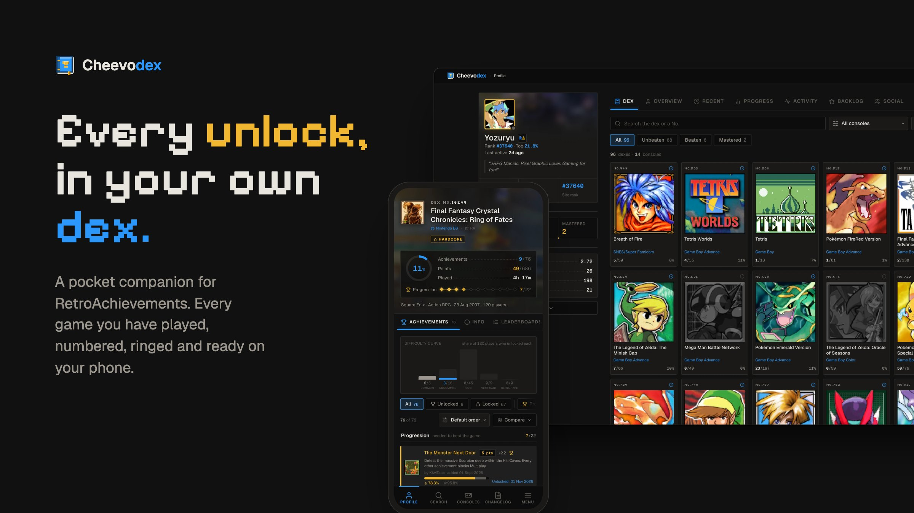
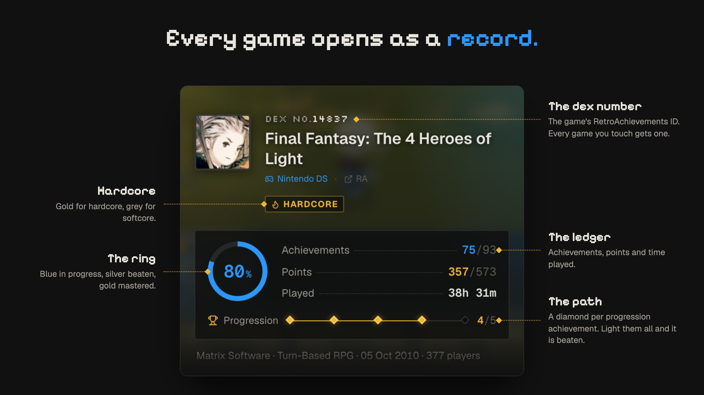
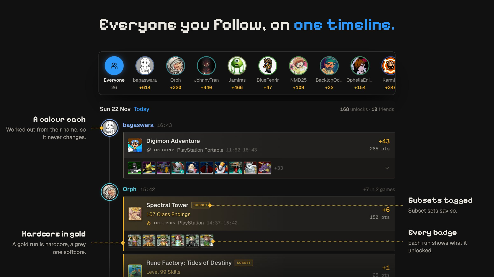
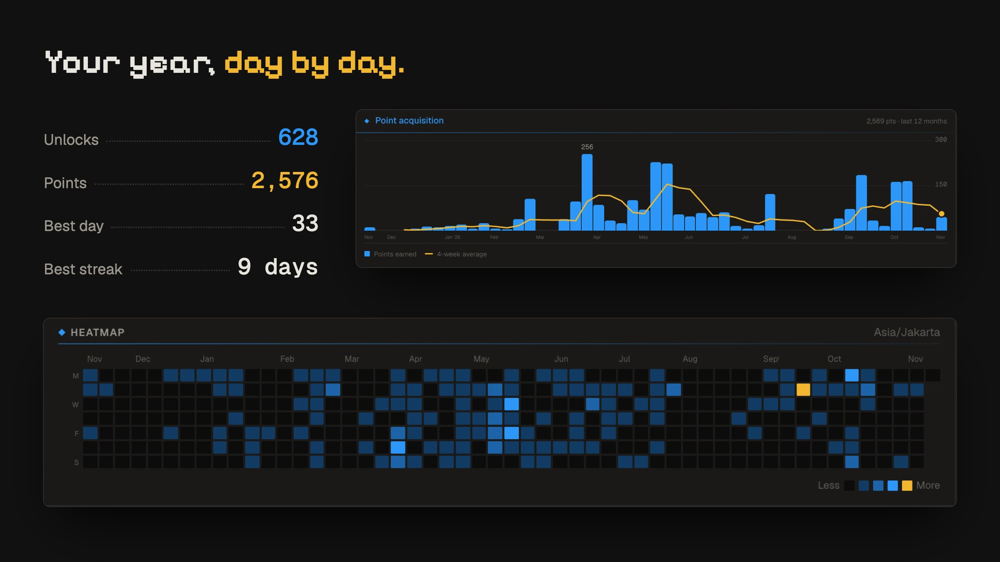
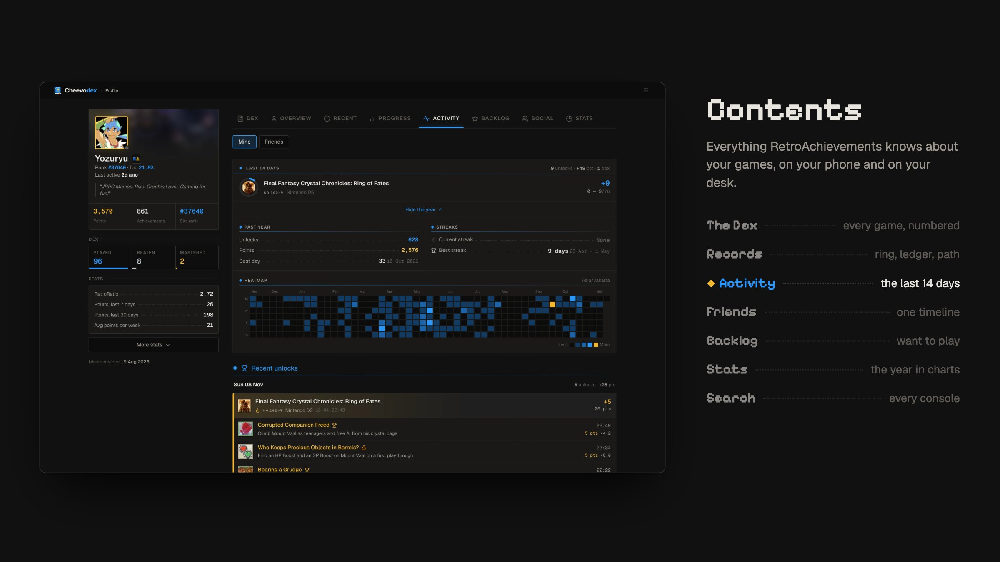

<p align="center">
  
</p>

<p align="center">
  <b>A pocket companion for RetroAchievements.</b><br>
  Every game you have played, numbered, ringed and ready on your phone. Free, open source, and it runs entirely in your browser.
</p>

<p align="center">
  <a href="https://yozuryu.github.io/cheevodex/">Open Cheevodex</a> ·
  <a href="https://yozuryu.github.io/cheevodex-site/">Website</a> ·
  <a href="#get-started">Get started</a> ·
  <a href="#run-your-own-copy">Run your own copy</a>
</p>

---

Cheevodex reads your [RetroAchievements](https://retroachievements.org) account and turns it into a dex: every game you have touched gets an entry and a number, its RetroAchievements game ID, and each one opens into a record of how far you are. There is nothing to install and no account to make. Sign in with your RA username and web API key, and it installs to your phone like an app.



## What you get

- **The Dex.** Every game you have played as a numbered entry with its progress ring. Search by name or dex number, filter to unbeaten, beaten or mastered, or read it console by console.
- **Dex records.** Each game opens as a record: a completion ring (blue in progress, silver beaten, gold mastered), achievements, points and time played, and a progression path with one diamond per progression achievement. Then the achievements themselves, the leaderboards, the community and the supported hashes.
- **Activity.** The games you moved in the last 14 days, every run of unlocks day by day, a year of streaks and a heatmap.
- **Friends.** Everyone you follow on one timeline, each in a colour worked out from their name. Compare any shared game side by side.
- **Backlog.** Your RetroAchievements want-to-play list as an index: the games you have started up next, then every game by console under A to Z, lit up once you start it, with the points on offer for the rest.
- **Stats.** Streaks, points across the year, masteries by month, consoles and how rare your unlocks are.
- **Search and consoles.** Find any game across every system RetroAchievements supports, or browse a console's whole library.
- **Anyone's dex.** Open any RetroAchievements username to read their dex and progress.
- **An app on your phone.** Install it from your browser's menu; it opens full screen and works on phones and computers alike.







## Get started

1. Log in at [retroachievements.org](https://retroachievements.org).
2. Open [Settings](https://retroachievements.org/settings), then **Keys**, and copy your **Web API Key**.
3. Open [Cheevodex](https://yozuryu.github.io/cheevodex/) and enter your username and the key.

To install it, choose **Install** or **Add to Home Screen** in your browser's menu.

## Privacy

Cheevodex has no server and no account of its own. It asks the [RetroAchievements web API](https://api-docs.retroachievements.org/) directly from your browser with your key. Your credentials stay in your browser's local storage, and cached responses in its IndexedDB, on your own device. Nothing is sent anywhere else.

## Run your own copy

The app is static files with no build step, so any static host works.

```bash
git clone https://github.com/yozuryu/cheevodex.git
cd cheevodex
npx serve .
```

Open `http://localhost:3000` and sign in. To host it, point GitHub Pages, Netlify, Cloudflare Pages or any static host at the repo root; there is no build command.

| | |
|---|---|
| UI | React 18 and Lucide icons from a CDN, JSX compiled in the browser by Babel |
| Styling | Tailwind CSS from a CDN, with the design tokens in `assets/tokens.css` |
| Data | The RetroAchievements web API, cached in IndexedDB |
| App | A web manifest and a service worker, so it installs and loads fast |

The docs in [`docs/`](docs/) cover the architecture, each page and the design rules.

### Updating the README images

The images above are posters built from screenshots of the app (`docs/images/shots/`). To rebuild them:

```bash
cd scripts && npm install && cd ..
node scripts/posters.js                       # posters from the stored screenshots
npx serve . -l 3000                           # in another terminal, for fresh screenshots
RA_USERNAME=you RA_API_KEY=yourkey node scripts/posters.js --capture
```

## License

[MIT](LICENSE). Unofficial and not affiliated with RetroAchievements; game names, art and achievement badges belong to their owners and creators.
